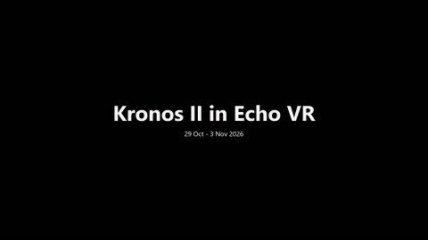

# Hi, I'm Tomski889 👋

**Echo VR modder · Rust · custom lobbies, maps and in-game plugins**

---

### 🛠️ What I'm working on

- **[echo-modding-tool](https://github.com/bollko/echo-modding-tool)**: props, sounds, lobbies, maps and in-game plugins for Echo VR
- **Kronos II lobby**: Lone Echo's ship rebuilt as the social lobby
- **Arena themes**: night mode, weather, snow, neon and live effects
- **LeanClip**: lightweight game clipper written in Rust

### 🎬 Kronos II build timelapse

Click for the full-quality video.

### 🧰 Tools

`Rust` · `egui` · `DirectX textures (BC6H)` · `Wwise audio`

### 📊 Stats

Not affiliated with Ready At Dawn or Meta.

